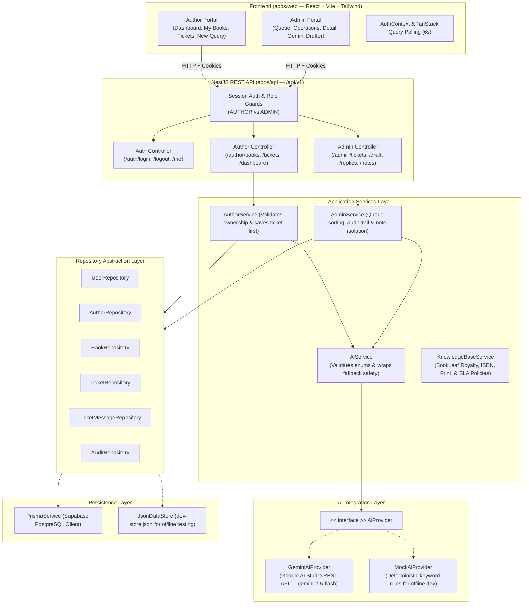

# BookLeaf Technical Assignment — Architectural Approach & Engineering Write-Up

## 1. What Was Prioritized

1. **Security & Server-Side Enforcement First**: The technical assignment mandates that client-supplied identity, ownership, and role data must never be trusted. Identity is resolved server-side directly from HTTP-only encrypted session cookies. All mutations and ticket lookups strictly verify author ownership before accessing or persisting data.
2. **Absolute Data Integrity & PostgreSQL Relational Schema**: We preserved all 10 authors and 18 books from `bookleaf_sample_data.json` without calculating artificial estimates or treating missing fields as zeros. Missing publication dates, null retail prices, and pending royalties are faithfully modeled with precision Decimal types in Supabase PostgreSQL.
3. **Strict Internal Note vs. Public Reply Isolation**: We enforced visibility boundaries at the database and service layer (`visibility: 'PUBLIC' | 'INTERNAL_NOTE'`). Internal staff notes are strictly excluded from author endpoints, both in the database queries (`findPublicByTicketId`) and in the AI prompt context.
4. **Resilient AI Integration (Google Gemini via AI Studio)**:
   - Configurable via `AI_PROVIDER=gemini` and `GEMINI_MODEL=gemini-2.5-flash`.
   - Structured JSON schema output (`responseMimeType: "application/json"`, strict enum validation).
   - Grounded draft generation with explicit policy constraints and anti-hallucination guardrails.
   - Timeout management (`AbortSignal.timeout(15000)`) and exponential backoff retry on HTTP 429/503.
   - Safe fallback: Ticket creation is guaranteed to succeed even during an AI outage or timeout.
5. **Durable Supabase PostgreSQL Persistence**:
   - Production relational storage managed with Prisma ORM.
   - Dual-mode support (`DATA_PROVIDER=postgres` for production / Supabase, `DATA_PROVIDER=json` for offline/isolated tests).
   - Relational foreign key integrity between `Author`, `Book`, `User`, `Ticket`, `TicketMessage`, and `AuditLog`.

---

## 2. System Architecture

---

## 3. How the Classification and Drafting Flow Works

### Inbound Classification Flow
1. **Ticket Saved First**: When an author submits a query via `POST /api/v1/author/tickets`, `AuthorService` immediately creates the ticket in PostgreSQL with status `OPEN`, default category `GENERAL_INQUIRY`, and default priority `MEDIUM`.
2. **Asynchronous / Safe Classification**: The service calls `AiService.classifyTicket()`, which delegates to `GeminiAiProvider`.
3. **Structured Gemini Output**:
   - Uses `gemini-2.5-flash` with `responseMimeType: "application/json"`.
   - Constrained by `responseSchema` with allowed `TicketCategory` and `TicketPriority` enum values.
   - Evaluates subject, description, book title, and status.
4. **Post-Processing & Validation**:
   - If Gemini returns valid enums, the ticket record is updated in PostgreSQL with the suggested category, priority, reasoning, confidence score, and `provider: 'gemini'`.
   - If an invalid value is returned, it is safely normalized to `GENERAL_INQUIRY` / `MEDIUM` with `confidence: 'low'`.
   - If Gemini errors, times out (>15s), or hits rate limits (429/503), the safe fallback values are retained with `provider: 'fallback'` without crashing or returning HTTP 500 to the author.

### AI Draft Generation Flow
1. **Admin Triggered**: From the admin ticket operations console, clicking **"Generate AI Draft (Gemini)"** triggers `POST /api/v1/admin/tickets/:ticketId/draft`.
2. **Context Compilation**:
   - `AdminService` retrieves ticket details, author profile (name, email, city), and book metrics (sales count, royalties earned, pending royalties, publication date).
   - Only `PUBLIC` conversation history is passed; internal staff notes are strictly excluded.
   - Policy sections for the relevant category (Royalty 80/20 split, ₹1,000 threshold, 5–7 day print SLA, free reprint verification) are extracted from `KnowledgeBaseService`.
3. **Prompt Grounding & Anti-Hallucination**:
   - System instructions explicitly forbid fabricating payout dates, transaction IDs, or promises not in policy.
   - Model outputs the draft addressed to the author by name.
4. **Human Review / No Auto-Publish**:
   - The draft is populated into an editable textarea.
   - It is **never published** to the author until the administrator reviews, personalizes, and clicks **"Send Official Reply"**.

---

## 4. Failure Handling & Resilience

| Scenario | Handling Strategy |
|---|---|
| **Gemini API Key Missing** | Provider logs warning, throws handled error, and returns safe fallback (`provider: 'fallback'`). |
| **HTTP 503 / 429** | Exponential backoff retry loop (`Math.pow(2, attempt) * 1000` ms) up to 2 retries; falls back gracefully if exhausted. |
| **API Timeout (>15s)** | `AbortSignal.timeout(15000)` cancels the hanging fetch; safe fallback is assigned. |
| **Model Returns Broken JSON** | Caught in `try/catch`, logged, and normalized to safe fallback. |
| **PostgreSQL Connection Issue** | Prisma retries connection; reports explicit error without printing sensitive credentials. |
| **Cross-Author Access Attempt** | Throws `ForbiddenException` immediately with audit logging. |

---

## 5. Automated Testing Suite

The application includes **42 automated unit and integration tests across 6 test suites**, achieving 100% pass rate:

1. **`src/ai/gemini-ai.spec.ts` (12 Test Cases)**:
   - Valid structured JSON classification from Gemini
   - Normalization of model-hallucinated enum values
   - Handling of malformed JSON responses
   - Handling of missing `GEMINI_API_KEY`
   - Retries on HTTP 503 Service Unavailable
   - Retries and backoff on HTTP 429 Too Many Requests
   - Timeout abort and fallback behavior
   - Ticket preservation: ticket saved before AI classification
   - Policy-grounded draft response generation
   - Author name and book context injection in prompts
   - Enforcement of anti-hallucination instructions
   - Verification that draft generation does not auto-publish public messages

2. **`src/data/postgres-data.spec.ts` (12 Test Cases)**:
   - Authors query with proper schema fields
   - Books query with relations
   - Ticket creation with foreign key enforcement
   - Ticket status and priority updates
   - PUBLIC message vs INTERNAL_NOTE message creation
   - Public message isolation (author view filters out internal notes)
   - Cross-author ticket access isolation (`ForbiddenException`)
   - Cross-author book attachment isolation (`ForbiddenException`)
   - Queue pagination and filtering
   - Unassigned tickets filter and count
   - Structured audit log entry creation
   - Monetary precision and Decimal preservation

3. **`src/auth/auth-and-security.spec.ts` (5 Test Cases)**:
   - Author authentication and session generation
   - Invalid credential rejection
   - Cross-author book and ticket access prevention
   - Strict internal note filtering from author responses
   - Global admin queue visibility across authors

4. **`src/admin/ticket-lifecycle.spec.ts` (5 Test Cases)**:
   - Cross-author book attachment rejection
   - Non-existent book ID validation
   - Ticket creation, reference generation, and classification
   - Admin override persistence (priority, category, status)
   - Admin reply persistence in author conversation
   - Queue filtering with empty results

5. **`src/data/seed-and-data.spec.ts` (4 Test Cases)**:
   - Import verification of all 10 authors and 18 books
   - Seeding idempotency
   - Preservation of null dates and zero monetary amounts
   - Persistence and reload safety

6. **`src/ai/ai-service.spec.ts` (4 Test Cases)**:
   - Category validation
   - Priority validation
   - Fallback on provider failure
   - Draft generation coordination
